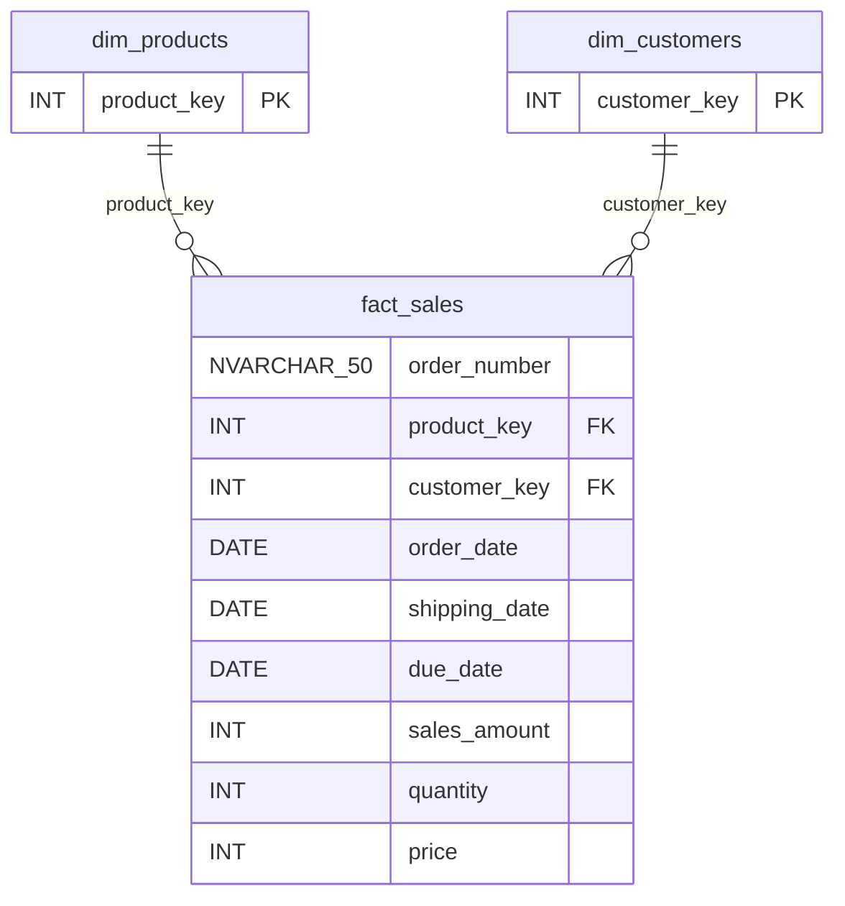

# Gold Layer Data Dictionary

This document describes the tables in the Gold layer of the data warehouse, including their purposes, columns, data types, and relationships.

## Contents

- [Model overview](#model-overview)
- [gold.dim_customers](#golddim_customers)
- [gold.dim_products](#golddim_products)
- [gold.fact_sales](#goldfact_sales)
- [Items to verify](#items-to-verify)

## Model overview

The Gold layer contains two dimension tables and one sales fact table.

| Table | Type | Column count |
|---|---|---:|
| `gold.dim_customers` | Dimension | 10 |
| `gold.dim_products` | Dimension | 11 |
| `gold.fact_sales` | Fact | 9 |
| **Total** | **3 tables** | **30** |

### Table relationships

The fact table references the dimension tables through their surrogate keys:

| Fact table column | Referenced dimension column |
|---|---|
| `gold.fact_sales.product_key` | `gold.dim_products.product_key` |
| `gold.fact_sales.customer_key` | `gold.dim_customers.customer_key` |

## `gold.dim_customers`

**Table type:** Dimension

**Purpose:** Stores customer details enriched with demographic and geographic data.

| Column name | Data type | Description | Key / notes |
|---|---|---|---|
| `customer_key` | `INT` | Surrogate key uniquely identifying each customer record in the dimension table. | Primary key |
| `customer_id` | `INT` | Unique numerical identifier assigned to each customer. | |
| `customer_number` | `NVARCHAR(50)` | Alphanumeric identifier representing the customer, used for tracking and referencing. | |
| `first_name` | `NVARCHAR(50)` | The customer's first name, as recorded in the system. | |
| `last_name` | `NVARCHAR(50)` | The customer's last name or family name. | |
| `country` | `NVARCHAR(50)` | The country of residence for the customer (e.g., 'Australia'). | |
| `marital_status` | `NVARCHAR(50)` | The marital status of the customer (e.g., 'Married', 'Single'). | |
| `gender` | `NVARCHAR(50)` | The gender of the customer (e.g., 'Male', 'Female', 'n/a'). | |
| `birthdate` | `DATE` | The date of birth of the customer, formatted as YYYY-MM-DD (e.g., 1971-10-06). | |
| `create_date` | `DATE` | The date and time when the customer record was created in the system. | Verify data type against description |

## `gold.dim_products`

**Table type:** Dimension

**Purpose:** Provides information about the products and their attributes.

| Column name | Data type | Description | Key / notes |
|---|---|---|---|
| `product_key` | `INT` | Surrogate key uniquely identifying each product record in the product dimension table. | Primary key |
| `product_id` | `INT` | A unique identifier assigned to the product for internal tracking and referencing. | |
| `product_number` | `NVARCHAR(50)` | A structured alphanumeric code representing the product, often used for categorization or inventory. | |
| `product_name` | `NVARCHAR(50)` | Descriptive name of the product, including key details such as type, color, and size. | |
| `category_id` | `NVARCHAR(50)` | A unique identifier for the product's category, linking to its high-level classification. | |
| `category` | `NVARCHAR(50)` | The broader classification of the product (e.g., Bikes, Components) to group related items. | |
| `subcategory` | `NVARCHAR(50)` | A more detailed classification of the product within the category, such as product type. | |
| `maintenance_required` | `NVARCHAR(50)` | Indicates whether the product requires maintenance (e.g., 'Yes', 'No'). | |
| `cost` | `INT` | The cost or base price of the product, measured in monetary units. | |
| `product_line` | `NVARCHAR(50)` | The specific product line or series to which the product belongs (e.g., Road, Mountain). | |
| `start_date` | `DATE` | The date when the product became available for sale or use. | Source description is incomplete |

## `gold.fact_sales`

**Table type:** Fact

**Purpose:** Stores transactional sales data for analytical purposes.

| Column name | Data type | Description | Key / notes |
|---|---|---|---|
| `order_number` | `NVARCHAR(50)` | A unique alphanumeric identifier for each sales order (e.g., 'SO54496'). | |
| `product_key` | `INT` | Surrogate key linking the order to the product dimension table. | Foreign key → `gold.dim_products.product_key` |
| `customer_key` | `INT` | Surrogate key linking the order to the customer dimension table. | Foreign key → `gold.dim_customers.customer_key` |
| `order_date` | `DATE` | The date when the order was placed. | |
| `shipping_date` | `DATE` | The date when the order was shipped to the customer. | |
| `due_date` | `DATE` | The date when the order payment was due. | |
| `sales_amount` | `INT` | The total monetary value of the sale for the line item, in whole currency units (e.g., 25). | |
| `quantity` | `INT` | The number of units of the product ordered for the line item (e.g., 1). | |
| `price` | `INT` | The price per unit of the product for the line item, in whole currency units (e.g., 25). | |

